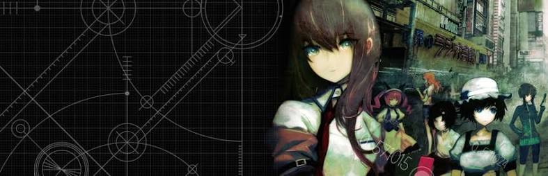

Into data, statistics, automation, and small experiments.

#### Featured work

- [glass-box](https://github.com/gmdkaio/glass-box) - interactive simulations of AI systems, from tokenization and sampling to retrieval, LoRA, and evaluation
- [llm-video-engine](https://github.com/gmdkaio/llm-video-engine) - native C++ engine that turns LLM-authored presentation plans into animated videos
- [github-analytics-dashboard](https://github.com/gmdkaio/github-analytics-dashboard) - automated GitHub data pipeline and visualization dashboard
- [amadeus-ai](https://github.com/gmdkaio/amadeus-ai) - local Qwen fine-tuning with LoRA, quantization, and dialogue/audio preparation
- [stochastic-dcf-engine](https://github.com/gmdkaio/stochastic-dcf-engine) - C/R Monte Carlo engine executing 1,000,000 DCF paths in ~0.045s

#### Personal workflow

- [kstack](https://github.com/gmdkaio/kstack) - my system for organizing projects, context, and reusable workflows when working with Claude and other AI tools

#### Other stuff

- [openrgb-agm700-driver](https://github.com/gmdkaio/openrgb-agm700-driver) - custom C tooling for OpenRGB and an AGM700 mouse
- [adguard](https://github.com/gmdkaio/adguard) - lightweight Python DNS sinkhole
- [cpu-temp-manager](https://github.com/gmdkaio/cpu-temp-manager) - CPU temperature monitoring daemon written in C
- [house-price-ml](https://github.com/gmdkaio/house-price-ml) - Random Forest housing-price prediction pipeline

#### Research and experiments

- [tone-check](https://github.com/gmdkaio/tone-check) - investigating how speech models recognize Mandarin tones and where they fail

